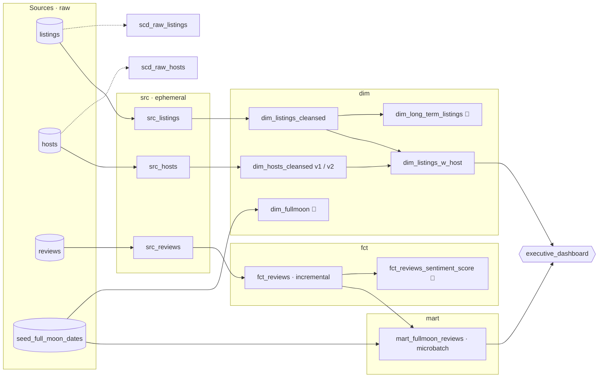
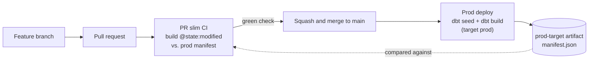

# Airbnb Analytics Pipeline · dbt Core + DuckDB

[](https://github.com/Arfat-khalid/dbt-airbnb-project/actions/workflows/prod-build.yml)


An end-to-end analytics engineering project on Airbnb data for Berlin: raw listings, hosts and reviews are loaded, cleansed, tested, historised and modelled into a fact table and a mart that answers a playful question: **are reviews written after a full moon more negative?**

The project is built with **dbt Core on DuckDB**, so it runs entirely on a laptop with no cloud warehouse, and it is deployed through **GitHub Actions** with slim CI on every pull request.

| Data | Rows |
|---|---|
| Listings | 17,499 |
| Hosts | 14,111 |
| Reviews (Jun 2009 – Oct 2021) | 410,284 |
| Full moon dates (seed) | 272 |

---

## Lineage



🐍 = Python model · dashed = SCD Type 2 snapshot · hexagon = exposure

---

## Tech stack

| Area | Tools |
|---|---|
| Transformation | dbt Core 1.12, dbt-duckdb |
| Warehouse | DuckDB (separate `dev.duckdb` / `prod.duckdb` files) |
| Packages | dbt_utils, dbt_expectations |
| Python models | pandas, TextBlob (sentiment), holidays |
| CI/CD | GitHub Actions: slim CI on pull requests, prod deploy on merge |
| Orchestration | Dagster, in a separate repository (see [Related](#related)) |

---

## What the project demonstrates

**Modelling**
- Layered structure: `src` (ephemeral, renaming only) → `dim` / `fct` → `mart`
- **Incremental** `fct_reviews` with a surrogate key (`dbt_utils.generate_surrogate_key`) and optional date-range backfills through `start_date` / `end_date` vars
- **Microbatch** incremental `mart_fullmoon_reviews` (yearly batches on `review_date`)
- **Model versions**: `dim_hosts_cleansed` v1 and v2, with an enforced **contract** and constraints
- **Python models** running inside DuckDB: German public holidays on full-moon dates, long-term listings, review sentiment scores
- **Snapshots** (SCD Type 2) for listings and hosts, `timestamp` strategy with `hard_deletes: invalidate`

**Data quality**
- Built-in generic tests (`unique`, `not_null`, `relationships`, `accepted_values`)
- Custom generic tests (`positive_values`, `minimum_row_count`) and singular tests (e.g. no review before its listing was created)
- dbt_expectations tests: row-count parity with the source, price quantiles and maximum, data types, regex on raw prices, distinct room types
- A **unit test** for the full-moon matching logic
- Failing rows are stored in a `test_results` schema (`store_failures`)
- Source freshness check on `reviews` (warn only: the dataset is a static snapshot ending Oct 2021)

**Engineering**
- Custom `generate_schema_name` macro for clean dev/prod schema naming
- `on-run-start` / `post-hook` hooks writing every model build to an `audit_log` table
- `drop_dev_schemas` run-operation to clean up development schemas safely (refuses to run on prod)
- Documentation with doc blocks, a custom overview page with assets, and an exposure
- YAML selectors and an analysis query

---

## Project structure

```
.
├── .github/workflows/      CI/CD: pr-slim-ci.yml, prod-build.yml
├── _prod_profiles/         profiles.yml with dev and prod targets (DuckDB paths, no secrets)
├── analyses/               ad-hoc analysis: full moon vs review sentiment
├── assets/                 images for dbt docs
├── macros/                 schema naming, dev cleanup, Jinja examples
├── models/
│   ├── src/                ephemeral source models
│   ├── dim/                dimensions (incl. versioned hosts, Python models)
│   ├── fct/                incremental reviews fact, sentiment scores
│   ├── mart/               full-moon reviews mart + unit test
│   ├── schema.yml          model properties, tests, contract, versions
│   ├── sources.yml         raw sources, source tests, freshness
│   └── dashboards.yml      exposure
├── seeds/                  seed_full_moon_dates.csv (raw CSVs are downloaded, see below)
├── snapshots/              SCD2 snapshots
├── tests/                  singular and custom generic tests
├── dbt_project.yml
├── packages.yml
├── selectors.yml
└── requirements.txt
```

---

## Environments

Both targets live in `_prod_profiles/profiles.yml`. The custom `generate_schema_name` macro keeps a prefix in dev and uses clean names in prod:

| | dev (`dev.duckdb`) | prod (`prod.duckdb`) |
|---|---|---|
| Models | `dev` | `prod` |
| Mart | `dev_mart` | `mart` |
| Raw seeds | `dev_raw` | `raw` |
| Test failures | `dev_test_results` | `test_results` |

---

## Getting started

Requirements: Python 3.12, Git. Commands below are for PowerShell on Windows; they work the same in bash with the usual path changes.

```powershell
git clone https://github.com/Arfat-khalid/dbt-airbnb-project.git
cd dbt-airbnb-project

python -m venv .venv
.venv\Scripts\Activate.ps1
python -m pip install -r requirements.txt
```

**Raw data.** The three raw CSVs are too large for Git. Download them into `seeds/`:

```powershell
curl.exe -sSfL -o seeds/raw_hosts.csv    https://dbtlearn.s3.amazonaws.com/hosts.csv
curl.exe -sSfL -o seeds/raw_listings.csv https://dbtlearn.s3.amazonaws.com/listings.csv
curl.exe -sSfL -o seeds/raw_reviews.csv  https://dbtlearn.s3.amazonaws.com/reviews.csv
```

Nine reviewer names in `raw_reviews.csv` contain doubled quotes (`"Mengnan ""M"""`) that DuckDB's CSV loader rejects. Clean them once (in Git Bash or any bash shell):

```bash
sed -i -E 's/""([^"]*)"""/ \1"/g' seeds/raw_reviews.csv
```

**Build:**

```powershell
dbt deps
dbt seed  --profiles-dir _prod_profiles --target dev
dbt build --profiles-dir _prod_profiles --target dev
```

**Explore:**

```powershell
dbt docs generate --profiles-dir _prod_profiles
dbt docs serve    --profiles-dir _prod_profiles     # http://localhost:8080
dbt show --profiles-dir _prod_profiles --inline "SELECT is_full_moon, review_sentiment, COUNT(*) FROM {{ ref('mart_fullmoon_reviews') }} GROUP BY ALL"
```

Use `--target prod` to build the production database instead.

---

## CI/CD



- **`prod-build.yml`** runs on every push to `main` (and manually): installs dependencies, downloads and cleans the raw data, builds prod and uploads `target/` (including `manifest.json`) as an artifact.
- **`pr-slim-ci.yml`** runs on every pull request: downloads the latest prod manifest and builds only what the change affects with `--select "@state:modified" --indirect-selection cautious`. Pull requests are merged only when this check is green.

---

## Design decisions

- **DuckDB instead of Snowflake.** The project runs locally and in CI at no cost. Snowflake-specific SQL was translated to DuckDB (e.g. `TO_DATE` / `DATEADD` → `CAST` / `INTERVAL`, fully qualified `database.schema` references in hooks).
- **`@state:modified` instead of `--defer`.** Each CI runner starts with an empty DuckDB file and the prod database is not reachable from CI, so there is nothing to defer to. `@state:modified` builds the changed models, their children and every parent those need; `--indirect-selection cautious` skips tests that reach outside that selection.
- **Doubled quotes in the raw CSV.** dbt-duckdb loads seeds with DuckDB's `COPY`, which does not treat `""` as an escaped quote for this file. The same `sed` cleanup runs locally and in both workflows, so all environments load identical data.
- **Lowercase schema names.** The course's `generate_schema_name` uppercases names (harmless on Snowflake). DuckDB keeps names as written, so the macro lowercases them to avoid "approximate match" conflicts.
- **dbt Fusion compatibility.** The project parses and builds on dbt Fusion (dbt v2) except for the Python models, which Fusion does not yet support on DuckDB. YAML was migrated to the `arguments:` test syntax; `fct_reviews` uses `on_schema_change='append_new_columns'` to work around a type-comparison issue in Fusion's DuckDB adapter.

---

## Related

- **Orchestration:** [dagster-airbnb](https://github.com/Arfat-khalid/<dagster-repo-name>): Dagster project that materialises these dbt models as assets, with schedules and partitions.

---

## Data source and credits

- Data: [Inside Airbnb](https://insideairbnb.com/) (Berlin), licensed under [CC BY 4.0](https://creativecommons.org/licenses/by/4.0/), in the version provided by the course below.
- Built while completing *The Complete dbt Bootcamp: Zero to Hero* by Zoltan C. Toth, rebuilt on DuckDB, extended with CI/CD and adapted for dbt Core 1.12 and dbt Fusion.
